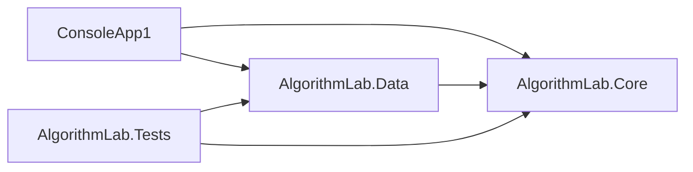
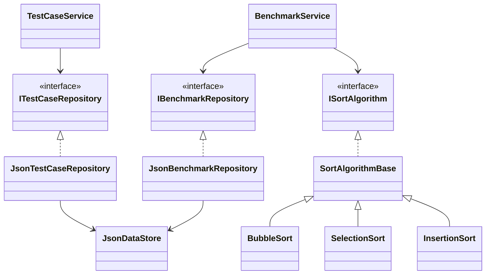

# 架構與後續類別關係

簡報可直接使用的 [類別圖 PNG](wireframes/class-diagram.png) 已於 Phase 5 匯出；下方 Mermaid 保留完整 Repository／服務依賴說明。

實線專案依賴已建立：

下圖的型別關係已於 Phase 4 完成：案例／測試服務、兩類 JSON Repository、共用 Store、排序介面／基底與三種排序。主控台透過服務執行，兩個 Repository 不各自保存獨立快取：

兩個 JSON Repository 必須共享同一 JsonDataStore，不能各自用獨立文件快取覆寫對方資料。Core 不引用 JSON、SQLite 或 UI，期末只增加 SQLite Repository／遷移及 WinForms 入口。
