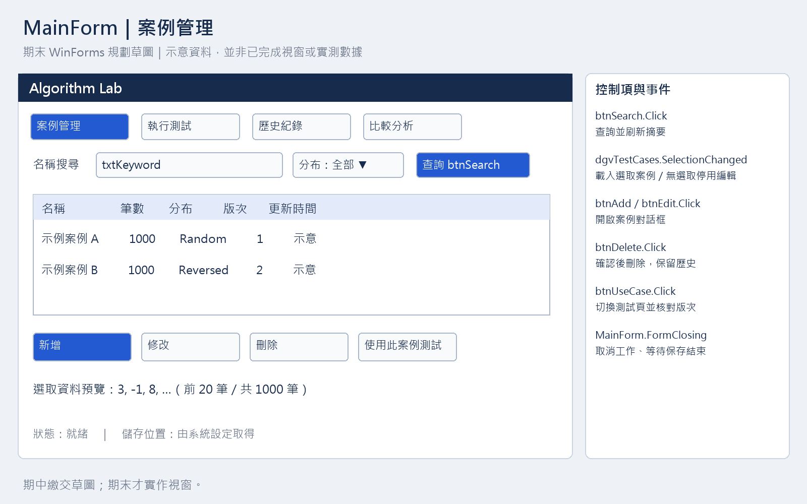
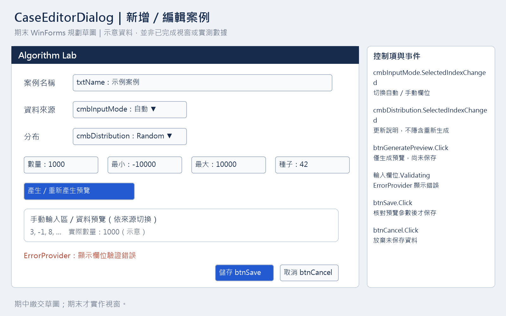
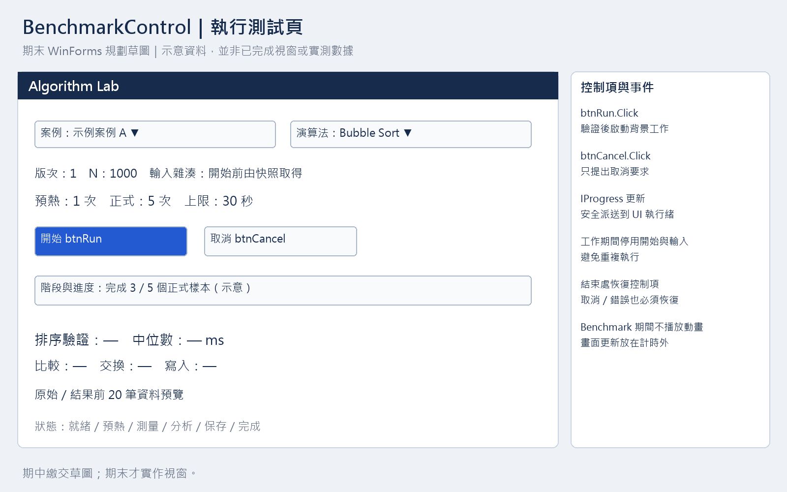

# 期末 WinForms 規劃草圖

2026-10-30。這些圖是期中必交的期末介面規劃，圖內案例與進度為示意，不是已實作的視窗或效能證據。實際期中程式以主控台操作。

完整 PDF：[三頁草圖](wireframes/winforms-wireframes.pdf)。下列 PNG 可直接放入簡報；可由 scripts/render-midterm-assets.py 重建。

## 主視窗：MainForm

| 控制項／事件 | 功能及邊界 |
| --- | --- |
| btnSearch.Click | 名稱／分布查詢，只刷新摘要 |
| dgvTestCases.SelectionChanged | 依 Id 載入選取資料；無選取時停用修改、刪除、測試 |
| btnAdd.Click、btnEdit.Click | 開啟 CaseEditorDialog；修改需保留畫面所見 Revision |
| btnDelete.Click | 明確確認後刪除，歷史輸入快照保留 |
| btnUseCase.Click | 切換測試頁，開始前重讀核對版次 |
| MainForm.FormClosing | 有工作時提出取消並等待保存，不直接終止執行緒 |

## 功能對話框：CaseEditorDialog

| 控制項／事件 | 功能及邊界 |
| --- | --- |
| cmbInputMode.SelectedIndexChanged | 切換自動／手動，啟用對應欄位 |
| cmbDistribution.SelectedIndexChanged | 更新說明，不隱含重新生成 |
| btnGeneratePreview.Click | 只生成候選資料與預覽，不保存 |
| txtName 等欄位.Validating | ErrorProvider 指出欄位錯誤；服務仍再次驗證 |
| btnSave.Click | 參數與預覽一致且驗證通過後才保存 |
| btnCancel.Click | 放棄未保存內容；改名不自行更換陣列 |

## 測試頁：BenchmarkControl

btnRun.Click 啟動單一背景工作；btnCancel.Click 只取消 token。IProgress 的畫面更新安全派送到 UI 執行緒，且不在計時範圍內。工作中停用開始與輸入，結束／取消／錯誤均恢復控制項。歷史與圖表讀取已保存紀錄，Benchmark 期間不播放動畫。

以上已滿足「至少兩個畫面或主畫面加對話框，標示控制項與事件」的草圖交付；不把草圖列為實際 WinForms 功能。
