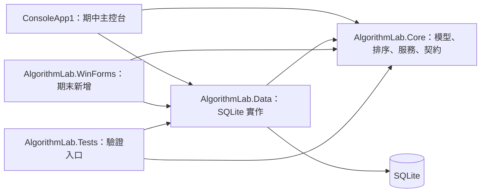
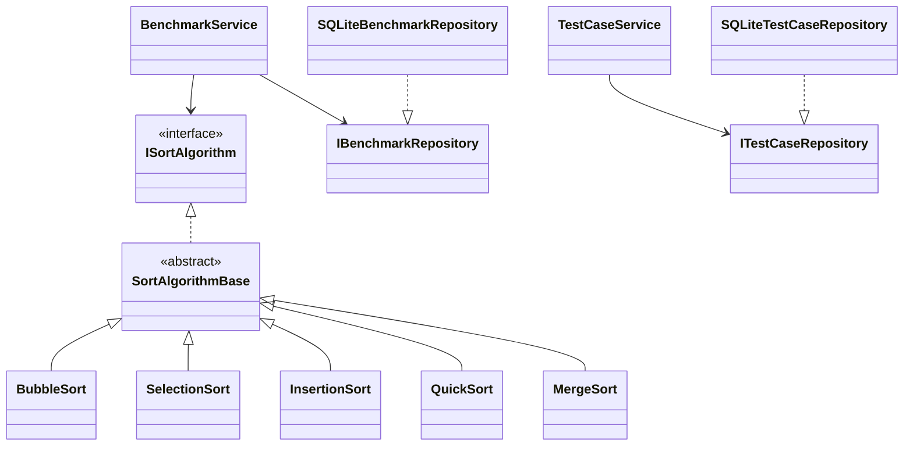

# C# 演算法效能比較與視覺化平台：開發計畫書

> 文件版本：1.0｜規劃日期：2026-10-28｜適用對象：Coding AI 與四人專題小組
>
> 本文件只定義需求、架構、契約、任務及驗收條件，不包含實作程式碼。所有標示為「待建立」的專案、函式與文件，都是後續執行者的工作。

## 1. 已確認決策與交付界線

| 項目 | 決策 |
| --- | --- |
| 專題名稱 | 基於 C# 物件導向之演算法效能比較與視覺化平台；英文簡稱 Algorithm Lab |
| 期中成果 | 可執行的主控台原型、真正使用的資料庫、WinForms 介面草圖、類別與測試說明 |
| 期末成果 | 延續期中核心與資料庫，增加 WinForms、進階排序、批次測量、圖表與 CSV 匯出 |
| 技術基準 | 儘量沿用現有 .NET Framework 4.7.2，不遷移到現代 .NET |
| 資料保存 | 必須使用資料庫；本計畫選擇本機 SQLite，案例與測試紀錄都要持久化 |
| 排序動畫 | 時間充裕才做，不能阻擋任何必做功能交付 |
| 小組人數 | 4 人，以 A、B、C、D 代表可替換的實際組員 |
| 最近期限 | 使用者提供「11/1 日前繳交」，本計畫按期中期限處理，採 2026-10-31 封版，時區 Asia/Taipei |
| 期末期限 | 尚未提供；只指定開發順序與驗收門檻，不虛構日期 |

SQLite 是依「需要資料庫、未限定品牌、短期完成、離線桌面操作」作出的架構選擇。它是真正的關聯式資料庫，不以 JSON 檔代替資料庫，也不需要部署資料庫伺服器。

老師原始要求圖片優先於參考對話中的助理建議：期中允許主控台原型／類別測試，不要求完成視窗；但必須繳交期末 WinForms 草圖。期中不以視窗功能完成度作為本計畫的驗收門檻。

## 2. 現有專案盤點

本次檢查範圍為工作區根目錄 `/mnt/c/Users/usr88/Desktop/期中/ConsoleApp1`。

| 現有項目 | 觀察 | 後續處理 |
| --- | --- | --- |
| `ConsoleApp1.slnx` | 僅包含一個 ConsoleApp1 專案 | 保留，後續將共用核心、資料存取及測試專案加入同一方案 |
| `ConsoleApp1/ConsoleApp1.csproj` | 傳統非 SDK 格式，目標 .NET Framework 4.7.2，輸出 Exe，目前 AnyCPU | 期中保留為主控台入口；新增檔案時須更新 Compile／Reference 項目 |
| `ConsoleApp1/Program.cs` | Main 尚無功能 | 只承擔程式啟動、依賴組合及進入主選單 |
| `ConsoleApp1/App.config` | 宣告 .NET Framework 4.7.2 執行環境 | 保留；有需要時增加設定，不寫入個人電腦的絕對資料庫路徑 |
| 既有功能 | 未見演算法、資料存取、WinForms 或自動測試 | 所有功能從可驗證的小階段建立 |
| 版本控制 | 目前目錄不是 Git repository | 原始碼以 Git 管理列入第一階段；提交內容須排除建置產物與個人資料庫 |

本次僅進行規劃，未執行 Windows 建置，也未證實開發電腦已裝妥 targeting pack 或 SQLite 原生依賴。後續 Phase 1 必須先完成 Windows 上的建置與資料庫連線驗證。

## 3. 產品目標、使用者與範圍

### 3.1 核心目標

讓學生或授課者建立整數測試案例，選擇不同排序演算法，取得可驗證的排序結果、執行時間與操作次數，並在程式重開後查閱案例及歷史紀錄。期末進一步比較相同輸入上的多種演算法，形成可重現的實驗資料。

平台限定單機、單一使用者操作。四位組員是開發者，不代表系統需要四個登入帳號；期中與期末均不加入登入、雲端同步或多人共用資料庫。

### 3.2 期中必做功能

| 編號 | 使用者功能 | 明確完成條件 |
| --- | --- | --- |
| M-01 | 測試案例 CRUD | 能新增、列出／搜尋、檢視、修改、刪除；所有變更寫入 SQLite |
| M-02 | 資料產生與手動輸入 | 支援隨機、已排序、反向排序、大量重複值及手動整數輸入 |
| M-03 | 三種基本排序 | Bubble Sort、Selection Sort、Insertion Sort 都能透過同一介面執行 |
| M-04 | 單次測試工作 | 使用者選一個案例與一種演算法；內部執行預熱、多次計時及一次操作統計 |
| M-05 | 結果與歷史 | 顯示排序前後摘要、正確性、時間統計、比較／交換／寫入次數；紀錄重開仍存在 |
| M-06 | 錯誤處理 | 錯誤輸入可修正；資料庫失敗有清楚訊息；排序錯誤不能被當作成功結果 |
| M-07 | 期末 UI 草圖 | 至少主視窗與案例編輯對話框，標示控制項名稱、事件與流程 |

對老師所稱「至少兩項核心功能」，本計畫以「案例管理」及「排序執行與結果紀錄」作為兩項可完整展示的核心流程，不只把新增與查詢計成兩項零散功能。

### 3.3 期末必做與選配

| 分類 | 功能 |
| --- | --- |
| 必做 F-01 | WinForms 介面整合，重用原有服務與資料庫 |
| 必做 F-02 | Quick Sort、Merge Sort，總共五種排序 |
| 必做 F-03 | 多演算法、多規模、多分布、可指定種子的批次測試 |
| 必做 F-04 | 執行時間與操作次數比較圖表、原始測量資料查閱 |
| 必做 F-05 | 摘要與原始樣本 CSV 匯出 |
| 必做 F-06 | 對照組／實驗組、控制變因、實測結果與限制說明 |
| 選配 O-01 | 排序動畫、暫停、單步與播放速度 |
| 選配 O-02 | Heap Sort、記憶體配置量研究；必做全部通過才評估 |

期中不納入 WinForms 實作、比較圖表、批次矩陣、動畫、外部檔案匯入、泛型排序、第三方外掛或複雜 ORM。

## 4. 技術選型與建置規範

| 類別 | 選擇 | 執行規範 |
| --- | --- | --- |
| 語言／執行環境 | C# 7.3、.NET Framework 4.7.2 | 明確設定語言版本；不使用 record、nullable reference types、頂層敘述等新語法 |
| 開發環境 | Windows 上的 Visual Studio／MSBuild | 安裝 .NET Framework 4.7.2 targeting pack；不以 WSL 的 dotnet build 成功與否代表 Windows 結果 |
| 專案格式 | 沿用傳統 .NET Framework 專案 | 先維持一致格式，避免短期內同時進行框架與專案格式遷移 |
| 平台 | 全方案 Debug x64、Release x64 | 將現有 AnyCPU 改為明確 x64，所有可執行專案與 SQLite 原生元件一致 |
| 資料庫 | SQLite、本機單一檔案 | 預設 `%LOCALAPPDATA%\AlgorithmLab\algorithm-lab.db`；顯示實際位置供展示與排錯 |
| Provider | `System.Data.SQLite.Core` 固定 1.0.119 | 使用 ADO.NET 參數化存取；避免誤裝包含其他框架整合的同名近似套件 |
| 計時 | `System.Diagnostics.Stopwatch` | 保存原始 timer ticks 與 Frequency，時間顯示毫秒 |
| 期末 UI | Windows Forms | 新增 WinForms 專案，不把既有 ConsoleApp1 強制改造成視窗程式 |
| 期末圖表 | Framework 的 `System.Windows.Forms.DataVisualization.Charting` | 使用框架組件引用，先不增加第三方圖表套件 |
| 測試工具 | 獨立 .NET Framework 4.7.2 主控台驗證專案 | 採具名測試、成功／失敗摘要及非零失敗結束碼，減少短期套件相容性工作 |

NuGet 官方頁面顯示，選定 Provider 透過 NetFramework 相依套件提供資產，其目標框架相容性包含 net472。本計畫據此採用此版本，實際原生 DLL 複製與啟動仍須在 Phase 1 驗證。[Provider 套件](https://www.nuget.org/packages/System.Data.SQLite.Core/1.0.119)、[NetFramework 相容性](https://www.nuget.org/packages/Stub.System.Data.SQLite.Core.NetFramework/1.0.119)

Provider 套件須在資料存取專案，以及每個會使用資料庫的可執行入口專案中，以相同版本明確管理，確認 SQLite 原生元件真的出現在最終執行輸出目錄；不能只確認類別庫能編譯。套件還原方式先沿用傳統專案慣例，將固定版本記錄在套件設定及 README。

正式效能結果使用 Release x64、未附加偵錯器的執行檔。Debug 仍可操作功能，但畫面與紀錄必須標示其建置模式。不得要求使用者關閉系統安全功能或強制變更全機設定。

若學校 Visual Studio 無法開啟 `.slnx`，另產生包含相同專案的傳統 `.sln` 作為相容入口，保留原檔；不因此更動核心架構。

## 5. 架構、專案與依賴方向

採小型分層架構，共用核心、資料存取與呈現層分離。以建構子傳入必要依賴，不加入 DI 容器、事件匯流排或大型架構框架。



Core 不得引用 Console、WinForms 或 SQLite；Data 不得直接輸出到主控台或操作控制項；兩種呈現層不得互相引用。Program 是依賴組合位置，不是業務邏輯容器。

建議交付結構如下，全部均相對於方案根目錄：

```text
ConsoleApp1.slnx
開發計畫書.md
README.md                                  待建立
ConsoleApp1/                               既有主控台入口
  Program.cs
  Presentation/ConsoleMenu.cs
  Presentation/ConsoleInputReader.cs
  Presentation/ConsoleResultFormatter.cs
AlgorithmLab.Core/                         待建立，類別庫
  Models/                                  案例、快照、請求、結果、統計及列舉
  Contracts/                               Repository 與排序介面
  Algorithms/                              基底類別與各排序
  Services/                                案例、資料產生、測試、統計及驗證
AlgorithmLab.Data/                         待建立，類別庫
  Database/                                路徑、連線、Schema 初始化
  Repositories/                            SQLite Repository
AlgorithmLab.Tests/                        待建立，主控台驗證專案
  AlgorithmTests/
  ServiceTests/
  DatabaseTests/
  TestRunner.cs
docs/                                      待建立
  requirements-traceability.md
  class-diagram.md
  winforms-wireframes.md
  wireframes/                              草圖 PNG／PDF
  test-results.md
  demo-script.md
  division-of-work.md
AlgorithmLab.WinForms/                     期末才建立
```

新增 Core、Data、Tests 都以 .NET Framework 4.7.2 建立。傳統 csproj 的檔案清單及專案參考由整合負責人統一維護，避免組員各自新增檔案卻未納入建置。

## 6. 領域模型與資料規則

### 6.1 模型責任

| 模型 | 必要資料／責任 |
| --- | --- |
| `TestCase` | Id、Name、Revision、Distribution、DataCount、Seed、GeneratorVersion、生成範圍、實際整數資料、建立／更新時間；維護案例不變條件 |
| `TestCaseDraft` | 新增／修改的候選輸入；驗證成功前不得成為持久化案例 |
| `TestCaseSummary` | 清單用資料，不載入所有案例的完整陣列 |
| `TestCaseSnapshot` | 凍結本次使用的案例名稱、版次、分布、生成參數、實際資料及 InputHash；不隨後續修改改變 |
| `AlgorithmDescriptor` | 穩定 Id、顯示名稱、版本、時間複雜度說明、穩定性及是否為期中演算法 |
| `BenchmarkOptions` | WarmupCount、MeasuredCount、整個工作排序時間上限、計時模式設定 |
| `BenchmarkRequest` | 一份輸入快照、AlgorithmId、Options；不持有控制項或開啟中的資料庫連線 |
| `SortExecutionContext` | Timing／Analysis 模式、取消權杖、每次呼叫專屬的 SortMetrics；不得跨測量共用 |
| `SortMetrics` | 64 位元 ComparisonCount、SwapCount、WriteCount；每次排序從零開始 |
| `BenchmarkSample` | 正式測量序號、原始 timer ticks、是否驗證成功；不包含預熱 |
| `BenchmarkStatistics` | MedianMs、MeanMs、MinMs、MaxMs、PopulationStdDevMs |
| `BenchmarkRun` | RunId、輸入快照、演算法與環境版本、設定、樣本、一次 Analysis 統計、狀態與錯誤 |
| `BenchmarkProgress` | 目前階段、已完成／總正式測量數；不得承諾排序內部精確完成百分比 |

### 6.2 案例不變條件

1. Id 使用 GUID，建立後不變；名稱去除頭尾空白後為 1～50 個字元，拒絕換行及控制字元。名稱允許重複，所有操作以 Id 辨識。
2. 使用者可建立的案例，期中 DataCount 為 1～5,000；期末上限提高至 10,000。空陣列只作排序單元測試，不作可儲存案例。
3. 實際資料必須都是 Int32；手動輸入允許負數、重複值及 Int32 極值，禁止小數、空 token、溢位值。
4. 手動輸入接受半形逗號、空白或換行分隔；逗號分隔中的缺值，例如 `1,,2` 或結尾逗號，應指出錯誤，不靜默丟棄。
5. 自動生成的 MinValue、MaxValue 限定在 -1,000,000～1,000,000，且 MinValue ≤ MaxValue；兩端皆包含。這個限制使生成器無須以溢位算術處理整數極值。
6. 自動生成種子為 Int32，未指定時由系統選定一次並顯示、保存；同一次建立過程不可在不同階段偷偷換種子。
7. 建立 Revision＝1；每次成功修改遞增 1。修改名稱時保留原始資料；只有明確要求重新產生或替換資料，才改變陣列。
8. DataCount 以實際資料長度為準，不能只相信輸入欄位。外部取得資料時取得副本，不得直接修改 TestCase 的內部陣列。
9. 時間以 UTC 保存，顯示時轉為 Windows 本機時區；本次交付排程與示範採台北時間。

### 6.3 資料分布定義

| Distribution | 定義 |
| --- | --- |
| Random | 依保存的種子，在含兩端的範圍內生成 N 個整數 |
| Sorted | 先用 Random 規則產生同一份多重集合，再以遞增順序排列 |
| Reversed | 與 Sorted 使用相同生成規則，再轉為非遞增順序 |
| FewUnique | 候選值取 MinValue 起連續的前 K 個整數，K＝10 與範圍內整數數量的較小值，再依種子抽取 N 次；N 很小時不保證實際含重複值 |
| Manual | 使用者提供的原始順序；生成種子與 GeneratorVersion 為空，最小／最大值由資料計算 |

生成器版本初始固定 `gen-1`。同種子重現以相同生成器及執行環境為條件；真正可重現的依據是資料庫保存的實際數值與雜湊，不是假設所有執行環境的亂數序列永遠一致。

### 6.4 輸入快照與雜湊

定義 `IntArrayCodec`，只負責陣列的固定格式序列化：各 Int32 以 InvariantCulture 十進位表示，以半形逗號連接，不含空白、BOM 或換行；這段文字只作資料庫欄位內容，不是外部 CSV 檔。

InputHash 為上述文字 UTF-8 bytes 的 SHA-256 小寫十六進位字串。範例 `[3, -1, 3]` 的標準文字為 `3,-1,3`。快照同時保存實際文字、筆數、格式版本 `intcsv-1` 與雜湊，讀取時驗證一致性。

## 7. 類別、介面與服務契約

### 7.1 排序抽象



此處 QuickSort、MergeSort 屬期末工作。封裝由模型的不變條件及資料副本體現；繼承由 SortAlgorithmBase 體現；介面與多型由同一 BenchmarkService 執行不同 ISortAlgorithm 體現，不為湊 OOP 項目建立無用途類別。

| 元件／操作名稱 | 輸入、輸出與約束 |
| --- | --- |
| `ISortAlgorithm.Descriptor` | 回傳穩定的 AlgorithmDescriptor；Id 不依中文顯示名稱變動 |
| `ISortAlgorithm.Sort` | 接收非 null 的整數陣列與 context，原地排序；結果由陣列取得、操作數由 context 取得；不得做 I/O、建立 Task、儲存資料或使用 UI |
| `SortAlgorithmBase.Sort` | 共用入口，檢查參數、取消狀態，交由抽象 SortCore 處理；具體類別只提供排序策略 |
| `SortAlgorithmBase.CompareValues` | 比較兩個資料值；Analysis 模式增加一次比較，不以相減比較而造成極值溢位 |
| `SortAlgorithmBase.SwapValues` | 不同索引時交換；Analysis 模式交換數加一、寫入數加二；同索引為無操作 |
| `SortAlgorithmBase.WriteValue` | 主陣列或排序用輔助陣列的單次元素寫入；Analysis 模式寫入數加一 |
| `SortAlgorithmBase.CheckCancellation` | 在主要迴圈／分割邊界檢查取消，長迴圈至少每 1,024 次迭代檢查；不以 UI 事件驅動排序 |
| `AlgorithmCatalog.GetAll／GetById` | 回傳演算法描述／實例工廠；未知 Id 明確拒絕；註冊只在組合入口完成，不在 UI 寫演算法名稱分支 |

演算法 Id 固定為 `bubble`、`selection`、`insertion`、`quick`、`merge`；初始版本 `1.0`。排序策略或統計規則變更時必須更新相關版本，歷史紀錄不能只保存名稱。

### 7.2 案例與儲存操作

| 元件／操作名稱 | 契約 |
| --- | --- |
| `DataGenerator.Generate` | 接受分布、N、範圍及種子；驗證後回傳資料與完整生成參數，不寫資料庫 |
| `TestCaseService.Create` | 驗證 draft、產生 Id／版次／時間，再透過 Repository 原子保存；回傳已建立案例 |
| `TestCaseService.Search` | 取得摘要後，以名稱的 OrdinalIgnoreCase 子字串及可選分布過濾；空白關鍵字代表全部；按更新時間新到舊、Id 次序穩定排列 |
| `TestCaseService.GetDetails` | 以 Id 取得完整案例；不存在回傳明確 NotFound，不以空案例代替 |
| `TestCaseService.Update` | 接受 Id、預期 Revision 與新內容；驗證並原子更新；舊版次不符時回報 Conflict，不能覆寫較新資料 |
| `TestCaseService.Delete` | 由呈現層確認後，以 Id 及預期 Revision 刪除；歷史結果保留其快照 |
| `TestCaseService.CreateSnapshot` | 開始測試前重新讀取案例並核對畫面所見 Revision；不符則要求重新選取；成功回傳防止外部修改的快照 |
| `ITestCaseRepository` | 提供摘要查詢、依 Id 讀取、新增、版次更新及刪除；定義於 Core，SQLite 實作位於 Data |
| `DatabaseInitializer.Initialize` | 首次建立 Schema；已存在則核對版本、確認連線設定；不重設現有資料 |
| `DatabaseConnectionFactory.Open` | 每次開啟並設定連線，驗證 foreign keys 啟用，設定 5 秒 busy timeout；呼叫者負責生命週期 |
| `IntArrayCodec.Encode／Decode` | 依第 6.4 節處理快照；格式錯誤、數量不符或雜湊失敗均拒絕 |

### 7.3 測試與結果操作

| 元件／操作名稱 | 契約 |
| --- | --- |
| `BenchmarkService.Run` | 接受 request、取消權杖及可選 progress；同步執行一個測試工作，回傳結果；由呈現層決定是否放到背景工作執行 |
| `SortResultValidator.Validate` | 比較本次輸出與事先建立的正確答案；同時確認長度與每個元素相同，不能只檢查單調性 |
| `BenchmarkStatisticsCalculator.Calculate` | 以有效正式樣本和 Frequency 計算統計；空樣本拒絕；不使用硬編碼效能資料 |
| `IBenchmarkRepository.CreateRunning` | 在排序前保存快照、設定、環境與 Running 狀態；保存失敗就不開始排序 |
| `IBenchmarkRepository.FinalizeRun` | 同一交易更新最終狀態、樣本及可用統計；不存在的 RunId 不自動補成成功紀錄 |
| `IBenchmarkRepository.GetHistory／GetDetails` | 可依案例 Id、演算法、狀態過濾；案例已刪除仍可依 RunId 查到快照 |
| `IBenchmarkRepository.MarkInterruptedRuns` | 單實例啟動時將上次遺留 Running 標記 Interrupted，不把未完成工作當成成功 |
| `EnvironmentInfoCollector.Collect` | 一次收集本次 Run 的程式版本、建置模式、位元架構、CLR、OS、機器名稱與計時頻率 |

對外錯誤至少區分 Validation、NotFound、Conflict、Persistence、Cancellation、SortValidationFailure。預期操作錯誤回到互動流程；未預期錯誤寫入診斷紀錄並顯示可理解訊息，不以空的 catch 隱藏問題。

## 8. SQLite 資料設計與交易

### 8.1 基本規範

- Schema 初始版本為 1，利用 SQLite user_version 管理；未知較新版本時停止寫入並提示，禁止自動刪庫重建。
- 每次開啟連線後、開始交易前啟用並確認 foreign keys。SQLite 外鍵不能只依賴資料表宣告或預設值。[SQLite 外鍵文件](https://www.sqlite.org/foreignkeys.html)
- SQL 值全部參數化；不得將名稱、搜尋文字、錯誤訊息直接串入 SQL。
- 使用短生命週期連線與交易，不讓 UI 或排序執行期間持有寫入交易。
- 案例的資料列與其數值陣列必須在同一交易新增／修改。SQLite 交易提供整批完成或回復的基礎。[SQLite 交易說明](https://www.sqlite.org/transactional.html)
- 預設單實例執行，以具名 Mutex 防止同一使用者同時開兩個入口修改同一資料庫；若已開啟則顯示提示並結束第二個入口。
- 資料庫路徑由啟動組合入口傳入，整合測試改用臨時資料夾，不能連到使用者正式資料庫。

### 8.2 `TestCases`

| 欄位 | 儲存型別與約束 |
| --- | --- |
| Id | TEXT，GUID 的 D 格式，主鍵 |
| Name | TEXT，必填，符合名稱規則 |
| Revision | INTEGER，必填，正整數 |
| Distribution | TEXT，必填，固定列舉名稱 |
| DataCount | INTEGER，必填，正整數；服務層施加期中／期末上限 |
| Seed、GeneratorVersion | INTEGER／TEXT；Manual 時為 NULL，其餘必填 |
| MinValue、MaxValue | INTEGER，必填；生成案例為設定範圍，Manual 為實際極值 |
| CreatedAtUtc、UpdatedAtUtc | TEXT，必填，UTC 的 round-trip ISO 8601 格式 |

### 8.3 `TestCaseValues`

| 欄位 | 儲存型別與約束 |
| --- | --- |
| TestCaseId | TEXT，外鍵連 TestCases，案例刪除時連帶刪除 |
| Position | INTEGER，從零起算 |
| Value | INTEGER，服務層驗證為 Int32 範圍 |
| 複合主鍵 | TestCaseId＋Position |

讀取數值必須依 Position 排序，驗證位置連續、數量符合 DataCount；資料不一致時回報完整性錯誤，不能悄悄補零或截斷。

### 8.4 `BenchmarkRuns`

| 欄位或欄位群組 | 儲存型別與規則 |
| --- | --- |
| Id | TEXT，GUID 主鍵 |
| TestCaseId | TEXT，可為 NULL；外鍵連 TestCases，刪除案例時設為 NULL |
| CaseRevision、CaseName | INTEGER／TEXT，建立 Run 當下的快照；即使原案例刪除仍保留 |
| Distribution、DataCount、Seed、GeneratorVersion、MinValue、MaxValue | 同輸入快照；批次臨時資料的 CaseRevision 可為 NULL，Seed 等依分布規則 |
| InputDataText、InputFormatVersion、InputHash | TEXT，必填；實際數值及第 6.4 節定義的格式與雜湊 |
| AlgorithmId、AlgorithmVersion、MetricsVersion | TEXT，必填；初始 MetricsVersion 為 `metrics-1` |
| WarmupCount、RequestedSampleCount | INTEGER，必填；預期預熱與正式測量次數 |
| TimeoutSeconds | INTEGER，必填 |
| Status | TEXT：Running、Completed、Cancelled、Failed、Interrupted |
| StartedAtUtc、FinishedAtUtc | TEXT；開始必填，Running 的結束時間為 NULL |
| StopwatchFrequency、IsHighResolution | INTEGER；開始時保存，頻率須大於零 |
| MedianMs、MeanMs、MinMs、MaxMs、PopulationStdDevMs | REAL；只有完整成功時填入，其他狀態為 NULL |
| ComparisonCount、SwapCount、WriteCount | INTEGER；取一次獨立 Analysis；若分析未完成則為 NULL |
| OutputPreviewText | TEXT，可為 NULL；成功時保存最後一個通過驗證的正式輸出前 20 筆 |
| AppVersion、BuildConfiguration、ProcessArchitecture、ClrVersion、OsVersion、MachineName | TEXT，必填，標識測試環境；不儲存使用者帳號或憑證 |
| ProcessorCount、DebuggerAttached | INTEGER，必填；邏輯處理器數量與是否附加偵錯器 |
| CpuModel、EnvironmentKey | TEXT；CPU 型號無法查得時標示 Unknown；EnvironmentKey 依第 17 節定義 |
| ErrorCode、ErrorMessage | TEXT，可為 NULL；顯示用摘要，詳細 stack trace 寫診斷紀錄 |

Completed 必須同時滿足：正式樣本數量正確、所有輸出正確、Analysis 完成及保存交易成功。不能以 0 取代不存在的時間或操作數。

### 8.5 `BenchmarkSamples`

| 欄位 | 儲存型別與約束 |
| --- | --- |
| RunId | TEXT，外鍵連 BenchmarkRuns；刪除 Run 時連帶刪除 |
| SampleIndex | INTEGER，正式測量從 1 起算 |
| ElapsedTimerTicks | INTEGER，64 位元非負值 |
| IsValid | INTEGER，0 或 1 |
| 複合主鍵 | RunId＋SampleIndex |

預熱與 Analysis 不插入此表。失敗或取消時可保存已完成樣本供診斷，但整個 Run 不產生正式聚合成績；圖表及實驗統計只使用 Completed 工作的有效樣本。

### 8.6 原子性、歷史與失敗處理

1. 新增／修改案例：驗證完成後，在同一交易處理 TestCases 與 TestCaseValues；任何一筆失敗全部回復。
2. 修改採預期 Revision 條件；若更新筆數不是一筆，區分案例不存在與版本衝突，不回報成功。
3. 刪除案例：刪除目前資料，保留 BenchmarkRuns 的輸入快照。名稱修改、資料重新生成也不修改舊 Run。
4. 建立 Run 先獨立提交 Running；排序在記憶體執行；結束後用另一交易保存樣本、狀態與統計。
5. 結束保存失敗時顯示「測試已結束，紀錄儲存失敗」，提供原結果的重試儲存，不重新排序；不可顯示「已保存」。若程式結束仍未保存，下一次啟動依遺留 Running 標記 Interrupted。
6. 缺少原生 DLL、資料庫無寫入權限、檔案損毀或鎖定逾時，顯示路徑與處理方向，保留原檔；禁止自動刪檔以求啟動成功。
7. 期中不提供歷史紀錄編輯及批次刪除。展示需要重設時，僅能使用明確指定的獨立展示資料庫。

## 9. 排序策略與操作數定義

### 9.1 指定策略，避免版本差異造成不一致

| 演算法 | 指定策略 | 特性與驗證重點 |
| --- | --- | --- |
| Bubble Sort | 相鄰元素比較、每輪縮小右界；整輪無交換立即結束 | 已排序輸入應提早結束；相等值不交換 |
| Selection Sort | 每輪從未排序區尋找最小值，僅在索引不同時交換 | 固定執行 N×(N−1)÷2 次資料比較；不為同索引增加交換 |
| Insertion Sort | 保存 key、把較大值向右位移，再放入 key | 不以連續交換代替位移；每輪最後放回 key 也算一次寫入，即使位置沒改變 |
| Quick Sort，期末 | 中間位置值作 pivot、三向分割，小於／等於／大於三區；以明確 stack 管理待處理區間 | pivot 保存為值，分割判斷一次三向 CompareValues；優先處理較小分區，避免深遞迴；大量重複值測試必做 |
| Merge Sort，期末 | Top-down 分割，每次 Sort 呼叫內配置一次輔助陣列，合併時相等值優先左側 | 輔助空間屬演算法成本，配置要在計時區間內；輔助陣列與主陣列寫入都計數 |

排序方向固定非遞減，不提供自訂 comparer 或遞減排序。框架 Array.Sort 只可用於產生 Sorted／Reversed 資料、建立正確性答案及測試，不可代替上述候選演算法。

### 9.2 `metrics-1` 統計規則

| 指標 | 精確定義 |
| --- | --- |
| ComparisonCount | 每呼叫一次資料值比較算一次；包含元素與 key／pivot 的比較；不包含索引邊界、迴圈條件、取消檢查或正確性驗證 |
| SwapCount | 交換兩個不同陣列索引的元素算一次；同索引不算；Insertion／Merge 的位移不偽裝成交換 |
| WriteCount | 排序期間對主陣列與排序輔助陣列的每次元素賦值算一次；交換固定兩次；區域變數賦值、輸入複製、正確性答案與資料生成不計 |

所有計數均為 long。不能直接用 SwapCount 判斷 Insertion 比 Bubble 更有效率；需要搭配 ComparisonCount 與 WriteCount 解讀。

以輸入 `[3,1,2]` 為固定驗證例：三種期中演算法均應產生 `[1,2,3]`；依本文件指定版本，Bubble 的比較／交換／寫入為 3／2／4，Selection 為 3／2／4，Insertion 為 3／0／4。以 `[1,2,3]` 測試時，Bubble 為 2／0／0、Selection 為 3／0／0、Insertion 為 2／0／2。

## 10. 效能測量協定

### 10.1 計時與分析分開

同一個演算法策略提供兩種 context 模式：

- Timing：停用操作計數與動畫觀察，只排序並保留必要取消檢查。
- Analysis：使用原始資料另一份副本，執行一次，累計操作數，不把這次耗時混入正式時間。

兩種模式必須執行相同排序策略，不能另外寫兩套可能行為不同的演算法。共用 helper 與取消檢查仍有呼叫或分支成本，因此報告將時間稱為「本平台在統一執行框架下的排序耗時」，不宣稱完全沒有量測開銷。

### 10.2 預設設定

| 設定 | 期中 | 期末 |
| --- | --- | --- |
| 每個 Run 的輸入 | 一個不可變快照 | 同一資料組提供給所有候選演算法 |
| 預熱次數 | 1 | 3 |
| 正式測量次數 | 5 | 預設 10，可設 5～30 |
| Analysis 次數 | 1 | 1 |
| 每個 Run 的排序流程時間上限 | 30 秒，涵蓋預熱、正式排序及 Analysis | 預設 30 秒，可設 10～120 秒 |
| 同時測試工作數 | 1 | 1；批次中的演算法仍依序執行 |
| 主要時間指標 | 中位數 ms | 中位數 ms；另保存平均、最小、最大、母體標準差 |

超時採合作式取消：deadline 觸發取消權杖，由排序檢查點退出；不使用 Thread.Abort 或強制終止執行緒。上限不是即時作業系統保證，實際回應受檢查點與作業系統排程影響。

### 10.3 單一 Run 的完整順序

1. 驗證 request、資料長度、演算法 Id、設定、快照格式與 InputHash；使用者案例需先核對 Revision。
2. 保存環境資訊；建立一份原始資料的獨立副本，以 Array.Sort 取得完整正確答案。這段不計時。
3. 建立並提交 Running 紀錄；初始保存失敗則停止，不開始排序。
4. 啟用本 Run 的 deadline 與外部取消權杖連結；各呼叫前都從同一原始快照產生新陣列。
5. 執行指定次數 Timing 預熱，每次都在排序後完整驗證；預熱不進入樣本表。
6. 每個正式樣本先完成複製與 context 建立，再開始 Stopwatch 計時；計時區間只包含演算法 Sort 呼叫，包括其內部輔助空間配置。
7. Sort 返回立即結束計時，之後再作完整正確性驗證、建立樣本物件及回報進度。複製、DB、輸出、驗證與 UI 更新都不在計時區間。
8. 正式樣本全部完成後，另取原始副本執行一次 Analysis；完成後亦驗證排序正確。
9. 確認原快照雜湊未變；若演算法誤改原始輸入，Run 失敗，不產生成績。
10. 依有效正式樣本計算時間統計；Analysis 的計數不是各次正式測量的加總。
11. 在單一交易保存結果與樣本，成功後才將工作視為 Completed 並告知已儲存。
12. 任一步驟取消、超時、錯誤或排序答案不符，保留相應狀態與摘要，回到可操作畫面；不沿用前一次成功結果。

Stopwatch 的 timer ticks 依 Frequency 換算，毫秒＝ticks×1000.0÷Frequency，不可直接當作 TimeSpan ticks。Frequency 及 IsHighResolution 是量測環境的一部分。[Stopwatch 官方說明](https://learn.microsoft.com/en-us/dotnet/api/system.diagnostics.stopwatch)

### 10.4 統計與顯示規則

- 中位數：將毫秒樣本排序，奇數取中間值，偶數取中間兩值平均。
- 平均數：所有有效正式樣本的算術平均；標準差採母體定義，分母為樣本數，欄位名稱明確標示 PopulationStdDev。
- 不任意刪除最慢樣本或取最好結果代表全部；原始樣本保留供檢查。
- 內部保留完整精度，顯示時間至少六位小數；原始 ticks 為零時標示「低於本次量測可分辨範圍」，不改寫成假造的正時間。
- 執行前後預覽最多各 20 筆，顯示總筆數與省略提示；不在計時中列印整個陣列。
- 不在測量間強制 GC.Collect，不提高程式優先權，也不平行跑多個排序來比較單次延遲。
- 首批 Release 結果記錄偵錯器是否附加；附加時顯示警示並標示紀錄，不列入正式研究比較。

## 11. 主控台互動規格

### 11.1 主選單

| 選項 | 功能 |
| --- | --- |
| 1 | 案例管理：列出、搜尋、檢視、新增、修改、刪除 |
| 2 | 執行測試：選案例、選演算法、確認設定、開始 |
| 3 | 歷史紀錄：列出最近紀錄、篩選、檢視細節 |
| 4 | 建立展示案例：明確操作後才建立固定種子案例，不在每次啟動重複插入 |
| 0 | 結束，釋放資源 |

啟動先初始化資料庫、處理遺留 Run，顯示程式版本、建置模式及 DB 路徑。若資料庫不可用，提供重試或結束，不假裝使用記憶體模式繼續。

### 11.2 案例管理流程

1. 清單顯示短序號、名稱、Id 摘要、筆數、分布與版次；短序號只對本次清單有效，實際操作轉成完整 Id。
2. 新增時先選自動生成或手動輸入，再填名稱及參數；確認預覽後保存，可在保存前取消。
3. 修改時顯示目前版次，分別提供「只改名稱」與「重新產生／替換資料」，避免改名稱就意外換掉輸入。
4. 刪除前顯示名稱、筆數、歷史紀錄保留說明，要求明確確認；取消不寫資料庫。
5. 無案例、無搜尋結果及不存在的選項均顯示明確訊息，返回選單。

### 11.3 執行與歷史流程

- 未選案例或演算法時不能開始；不存在可用案例時導向案例管理。
- 開始前顯示案例名稱、Revision、N、InputHash 摘要、演算法、預熱／測量次數與時間上限。
- 主控台以 Ctrl+C 取消目前 Run，事件處理只提出取消要求；由主流程保存狀態並返回選單。輸入串流結束時正常退出，避免無限重試。
- 完成時顯示 RunId、狀態、排序驗證、中位數／最小／最大時間、一次 Analysis 計數與原始／結果預覽。
- 歷史預設列最近 20 筆，支援載入更多及依狀態／演算法篩選；細節要能查到所有正式樣本、輸入快照及環境資訊。
- Failed、Cancelled、Interrupted 使用不同文字，時間欄位顯示「未完成」，不顯示誤導的 0 ms。

## 12. WinForms 草圖與事件規格

本節是期中必交草圖的規格，也是期末實作依據。期中將本節布局整理成 `docs/winforms-wireframes.md`，另輸出至少兩張可獨立閱讀的 PNG 或一份 PDF；圖中使用示意資料，不標成實測結果。這是後續交付項目，本計畫書本身不代表草圖檔已建立。

### 12.1 主視窗 MainForm

```text
┌ Algorithm Lab ─────────────────────────────────────────────┐
│ [測試案例] [執行測試] [歷史紀錄] [比較分析：期末]             │
│ 搜尋名稱 [                  ] 分布 [全部 ▼] [查詢]        │
│ ┌ 案例清單 ─────────────────────────────────────────────┐ │
│ │ 名稱           筆數       分布       版次       更新時間 │ │
│ │ 隨機1000       1000       Random      1          ……      │ │
│ └───────────────────────────────────────────────────────┘ │
│ [新增] [修改] [刪除] [使用此案例測試]                       │
│ 選取資料預覽：3, -1, 8, …（前20筆／共1000筆）              │
│ 狀態：就緒                  資料庫位置：……                 │
└───────────────────────────────────────────────────────────┘
```

| 控制項 | 事件 | 行為與防呆 |
| --- | --- | --- |
| `btnSearch` | Click | 用目前搜尋條件刷新摘要，不修改資料 |
| `dgvTestCases` | SelectionChanged | 載入選取案例細節；沒有選取時停用修改、刪除、測試 |
| `btnAdd` | Click | 開啟空白 CaseEditorDialog，成功保存後刷新清單 |
| `btnEdit` | Click | 以 Id／Revision 開啟編輯，版次衝突時重新載入 |
| `btnDelete` | Click | 明確確認後刪除，保留歷史快照 |
| `btnUseCase` | Click | 切換執行頁並傳遞案例 Id／Revision，開始前重新核對 |
| `MainForm` | FormClosing | 有工作時要求取消並等待結束；不直接切斷儲存交易 |

### 12.2 案例編輯對話框 CaseEditorDialog

```text
┌ 新增／編輯測試案例 ────────────────────────────────────────┐
│ 名稱 [                                 ]                 │
│ 來源 [自動生成 ▼]       分布 [Random ▼]                    │
│ 數量 [1000]  最小 [-10000] 最大 [10000] 種子 [42]          │
│ [產生／重新產生預覽]                                      │
│ 手動資料 [                                              ]│
│ 預覽：3, -1, 8, …       實際數量：1000                     │
│ 驗證訊息／欄位錯誤                                        │
│                                     [儲存] [取消]        │
└───────────────────────────────────────────────────────────┘
```

| 控制項 | 事件 | 行為與防呆 |
| --- | --- | --- |
| `cmbInputMode` | SelectedIndexChanged | 自動／手動切換；只啟用相應欄位 |
| `cmbDistribution` | SelectedIndexChanged | 顯示分布說明，不隱含重新生成 |
| `btnGeneratePreview` | Click | 在記憶體生成資料；未儲存前不寫入 DB |
| `txtName` 等輸入欄位 | Validating | 配合 ErrorProvider 顯示欄位錯誤；服務層仍再次驗證 |
| `btnSave` | Click | 保存目前已確認的資料；生成參數改變後必須先重建預覽，不能保存參數與陣列不一致的案例 |
| `btnCancel` | Click | 放棄未儲存內容並關閉，不自動保存 |

編輯既有案例時預設保留資料；重新生成是明確操作。手動模式 DataCount 由解析結果顯示，不能與實際長度分開輸入。

### 12.3 執行測試頁 BenchmarkControl

```text
┌ 執行測試 ─────────────────────────────────────────────────┐
│ 案例 [隨機1000 ▼]       演算法 [Bubble Sort ▼]              │
│ 版次 1  N=1000  輸入雜湊 ……                               │
│ 預熱 1 次   正式測量 5 次   上限 30 秒                      │
│ [開始測試] [取消]        進度 [已完成3／5個正式樣本]         │
│ 排序驗證：—    中位數：— ms    比較／交換／寫入：—          │
│ 原始資料預覽：……         排序結果預覽：……                  │
│ 狀態：就緒／預熱／測量／操作分析／儲存／完成                │
└───────────────────────────────────────────────────────────┘
```

- `btnRun.Click`：驗證選擇後建立一次背景工作，停用開始與會改變本次輸入的控制項。
- `btnCancel.Click`：只取消權杖，不將畫面立即假裝恢復為完成；待服務返回後更新狀態。
- `Task.Run` 執行同步服務；UI 執行緒利用 IProgress 或安全派送接收階段進度，不能跨執行緒直接操作控制項。
- 成功、取消或錯誤都在統一結束處恢復控制項；不得用 Application.DoEvents 維持假性回應。
- 進度更新發生在計時區間之外；這個頁面不在 Benchmark 期間播放排序動畫。

### 12.4 歷史與比較頁

歷史頁以唯讀 DataGridView 顯示 RunId、案例快照名稱、演算法、N、狀態、時間、建立時間；選取後顯示樣本與環境。比較頁只選 Completed 紀錄，並在圖例／說明中顯示分布、種子群組與樣本數。

期末圖表使用 Framework 的 Chart 控制項；官方文件對應的組件為 System.Windows.Forms.DataVisualization.dll。[Chart 官方文件](https://learn.microsoft.com/en-us/dotnet/api/system.windows.forms.datavisualization.charting.chart?view=netframework-4.8.1)

## 13. 開發階段與交接門檻

每個階段完成後，執行者更新測試證據，再開始依賴它的任務。可獨立作業的工作在第 14 節分配，但不能跳過共用契約。

### Phase 0：凍結規格與建立協作基準

| 項目 | 規格 |
| --- | --- |
| 前置 | 本計畫書已確認 |
| 任務 | 建立版本控制及忽略規則；確認角色；凍結命名、模型、Repository 契約、統計規則、目標平台及文件位置 |
| 交付 | 原始碼協作入口、分工文件、需求對照表初稿、可供各人開發的專案骨架 |
| 驗收 | 4 人可開啟同一方案；不存在不一致的自訂模型或第二套資料庫規格 |

### Phase 1：Windows 建置與 SQLite 最小連線

| 項目 | 規格 |
| --- | --- |
| 前置 | Phase 0 |
| 任務 | 建立 Core／Data／Tests；統一 x64；還原固定 Provider；實作路徑、連線、Schema v1 初始化與單實例啟動 |
| 交付 | 能建立四張表、關閉後重新連線的最小程式；README 環境準備段落 |
| 驗收 | 在 Windows Release x64 執行；DB 位於預期位置；第二次啟動不清空；外鍵確實啟用；SQLite 原生 DLL 能載入 |
| 失敗處理 | 優先解決原生元件與平台配置，不把「暫用 List」當作資料庫功能完成 |

### Phase 2：案例 CRUD 與資料生成

| 項目 | 規格 |
| --- | --- |
| 前置 | Phase 1 的資料庫初始化；服務規格可與 Phase 1 並行準備 |
| 任務 | TestCase、Draft、Snapshot、Codec、DataGenerator、TestCaseService、SQLiteTestCaseRepository 與案例選單 |
| 交付 | 可管理案例的主控台；固定種子生成與手動輸入；資料交易測試 |
| 驗收 | 新增→查詢→修改→重開→仍存在→刪除；錯誤輸入不寫入；更新失敗無半份陣列；種子與實際資料可核對 |

### Phase 3：三種排序與統計契約

| 項目 | 規格 |
| --- | --- |
| 前置 | Phase 0 契約；不依賴資料庫完成 |
| 任務 | 排序介面、基底、Catalog、三種排序、Timing／Analysis context、取消檢查及正確性驗證器 |
| 交付 | 完全不依賴主控台或 DB 的排序核心，以及可重跑的演算法測試 |
| 驗收 | 第 16 節排序案例全部通過；指定操作數一致；取消可退出；演算法不修改呼叫方保存的原始快照 |

### Phase 4：效能執行與歷史持久化

| 項目 | 規格 |
| --- | --- |
| 前置 | Phase 1、2、3 |
| 任務 | BenchmarkService、統計計算、環境收集、Run／Sample Repository、狀態處理與歷史選單 |
| 交付 | 由已保存案例產生已保存測試結果的完整流程 |
| 驗收 | 一次預熱＋五次正式＋一次 Analysis；時間與統計不混用；重開可查；取消／錯誤不變成 Completed；案例修改／刪除不改舊快照 |

### Phase 5：期中整合、草圖與封版

| 項目 | 規格 |
| --- | --- |
| 前置 | Phase 2～4 已整合；UI 草圖與報告可提前製作 |
| 任務 | 完成完整選單及錯誤訊息、草圖圖檔、類別圖、需求對照、測試結果、示範腳本、乾淨電腦啟動驗證 |
| 交付 | Release x64 執行資料夾、完整原始碼、資料庫建立方式、文件與簡報素材 |
| 驗收 | 所有期中硬性門檻通過；依示範腳本操作不中斷；不需編輯原始碼才能完成展示 |

### Phase 6：期末 WinForms 整合

| 項目 | 規格 |
| --- | --- |
| 前置 | 期中封版 |
| 任務 | 新增 AlgorithmLab.WinForms；依第 12 節實作主視窗與對話框；背景測試、取消、關閉流程；沿用同一 DB 路徑 |
| 驗收 | 可直接讀取期中資料庫；核心不引用 WinForms；主控台仍可作除錯入口；UI 執行時可回應且不接受重複開始 |

### Phase 7：進階排序

| 項目 | 規格 |
| --- | --- |
| 前置 | Phase 3；可與 Phase 6 分工並行 |
| 任務 | 依第 9 節增加 Quick／Merge、Catalog 註冊與同一套驗證 |
| 驗收 | 五種演算法經同一測試管線執行；不改 BenchmarkService 來特判新演算法；重複值與極值正確 |

### Phase 8：批次、圖表與匯出

| 項目 | 規格 |
| --- | --- |
| 前置 | Phase 6、7 |
| 任務 | 批次規劃與 Schema v2、順序控制、圖表資料聚合、CSV 匯出 |
| 驗收 | 同一資料組在各演算法間 InputHash 相同；可取消；資料庫遷移不遺失期中資料；圖表可追溯原始 Run 與樣本 |

### Phase 9：正式實驗與期末報告

| 項目 | 規格 |
| --- | --- |
| 前置 | Phase 8 |
| 任務 | 按第 17 節收集正式 Release 結果；產出實驗表、圖及分析；記錄實際設定與限制 |
| 驗收 | 每項結論有實測資料來源；缺漏／失敗組合清楚標示；不把示意曲線當成實驗結果 |

### Phase 10：選配排序動畫

| 項目 | 規格 |
| --- | --- |
| 前置 | Phase 9 必做驗收通過且仍有餘裕 |
| 任務 | 增加獨立示範模式與受限步驟觀察，支援播放、暫停、單步與重設 |
| 驗收 | 動畫資料不進正式時間；N 上限 128；不預先保存無上限的所有陣列快照；Benchmark 模式不掛動畫觀察者 |

## 14. 四人分工與整合規則

下表是人員責任分配，A～D 換成實際姓名即可。Coding AI 依任務及檔案所有權執行，不代表需要自動建立四個 Agent。

| 角色 | 期中主責 | 主要交付與檔案 | 期末延續 |
| --- | --- | --- | --- |
| A：整合與執行流程 | 共用契約審定、主控台選單、BenchmarkService、方案與 csproj 整合 | ConsoleApp1、Core/Services/BenchmarkService、專案參考、README | WinForms 測試頁與背景工作、整合 |
| B：案例與資料庫 | DataGenerator、TestCaseService、SQLite Schema、兩類 Repository | Core 的案例相關模型／服務、AlgorithmLab.Data | Schema v2、批次紀錄、歷史與匯出資料來源 |
| C：演算法與分析 | 排序介面／基底、三種基本排序、正確性驗證器、統計計算 | Core/Algorithms、排序與統計模型、相關測試 | Quick／Merge、批次執行策略、操作數分析 |
| D：驗證與交付設計 | 測試 Runner、整合測試、WinForms 草圖、類別圖、需求對照與示範腳本 | AlgorithmLab.Tests、docs、報告素材 | WinForms 案例／歷史／比較頁、圖表、實驗報告 |

共用模型、Contracts、方案檔、套件設定、App.config 由 A 維護最後整合版本；B／C／D 提出調整時同步更新契約與使用端，不各自複製一份相似類別。

同一天可並行的工作：B 做 DB 與案例，C 做純排序，D 做草圖及測試規格，A 做入口及測試管線。每日至少一次合併並完整建置；只有可編譯、附驗證紀錄的工作才標示完成。

每位組員應能說明自己負責的類別、輸入輸出、錯誤情況及與其他模組的關係，不只提交 AI 產生的檔案。

## 15. 期中時程與縮減順序

以下為交付倒排，不假設每位組員全日有空。若時間不足，依本節縮減選配及展示規模，保留期中硬性門檻。

| 日期，台北時間 | A | B | C | D | 當日共同里程碑 |
| --- | --- | --- | --- | --- | --- |
| 2026-10-28 | 確認契約、方案與入口骨架 | 確認 SQLite 套件與資料路徑 | 確認排序與計數契約 | 建立需求對照及兩張 UI 草圖初稿 | Phase 0；啟動 Phase 1 的建置／原生元件驗證 |
| 2026-10-29 | 主控台案例流程、測試管線骨架 | 完成 Schema、案例交易、生成與 CRUD | 完成三種排序及指定計數測試 | 完成測試 Runner、DB 測試、草圖及類別圖 | Phase 1～3 的主要功能可單獨驗收 |
| 2026-10-30 | 整合 BenchmarkService 與完整選單 | 完成 Run／Sample 保存、歷史快照與錯誤處理 | 協助計時／統計／取消驗證 | 執行端到端測試、整理報告證據 | 當日晚間具備完整案例→排序→保存→重開查詢流程 |
| 2026-10-31 | Release 封版、整理來源及操作說明 | 第二台電腦／帳號的 DB 與原生依賴驗證 | 確認結果與演算法說明 | 補齊草圖圖檔、報告、示範彩排 | Phase 5 通過，完成繳交包；當日不增加新功能 |
| 2026-11-01 | 按課程實際規定提交／確認收件 | 同左 | 同左 | 同左 | 不將這天當成可用開發緩衝；若「日前」要求更早，10/31 已具備可交付版本 |

**無法削減的期中項目：**真正資料庫 CRUD、至少兩個有用途類別、兩項完整核心流程、錯誤輸入處理、可執行排序、結果重開可查、WinForms 草圖與測試證據。

**發生延誤時依序縮減：**主控台美化與表格排版 → 展示案例數量／展示資料規模 → 次要歷史篩選。CSV、圖表、進階排序、動畫本來就不在期中範圍，不能先做這些再犧牲資料庫或草圖。

若最小閉環在 10/30 晚間仍未成立，10/31 只修整合與交付阻塞，不再擴充主控台操作花樣；不得以虛構成績或截圖代替可執行原型。

## 16. 測試策略與驗收案例

驗證專案以可重跑的具名測試執行，至少輸出測試名稱、通過／失敗、原因及總結；有任一失敗即使用非零結束碼。以下是待實作的驗收規格，並非本次已執行結果。

### 16.1 排序與服務測試

| 編號 | 情境 | 預期結果 |
| --- | --- | --- |
| A-01 | 空陣列、單一元素 | 每種 Sort 均正常返回，數值正確；空陣列不代表允許存成案例 |
| A-02 | null 陣列或 null context | 明確參數錯誤，不發生不明 NullReferenceException |
| A-03 | 已排序、反向、全部相同、大量重複、混合負數 | 與 Array.Sort 的完整答案一致 |
| A-04 | 包含 Int32.MinValue／MaxValue | 不因比較相減溢位而排序錯誤 |
| A-05 | 固定種子產生多組 2～1,000 筆資料 | 各種演算法逐項結果相同，快照未改變 |
| A-06 | 第 9.2 節兩個三元素案例 | 比較／交換／寫入次數完全一致；重跑不累加前次計數 |
| A-07 | Timing 與 Analysis 使用相同輸入 | 結果一致；Timing 不產生操作計數，Analysis 不混進樣本 |
| A-08 | 已取消權杖；執行中取消 | 明確取消，不繼續整批迴圈、不回報 Completed |
| S-01 | 案例名稱空白、筆數為零／超限、範圍顛倒、整數溢位 | 指出欄位錯誤；資料庫無新增／更新 |
| S-02 | 手動資料 `1,,2`、尾逗號、小數 | 拒絕缺值／非法 token；顯示可定位的錯誤 |
| S-03 | 同一 gen-1 參數與種子 | 同環境得到相同資料；Codec 往返後資料、順序與 Hash 不變 |
| S-04 | 範圍最小值＝最大值，N＝1 及 N＝上限 | 正常產生；FewUnique 不越界 |
| S-05 | 修改名稱；明確重新生成；舊 Revision 更新 | 前者保留數值，後者替換數值；舊版次回報 Conflict |
| S-06 | Frequency＝1,000，ticks 樣本 1、2、3、4、5 | 毫秒為 1～5；中位數／平均 3，最小 1，最大 5，母體標準差為平方根 2 |
| S-07 | 四個有效樣本；空樣本 | 偶數中位數取中間兩值平均；空樣本拒絕 |
| S-08 | 測試用錯誤演算法輸出有序但遺失／重複元素 | 完整答案驗證失敗，不因「已排序」而通過 |
| S-09 | 中途錯誤或取消，僅有部分樣本 | 不產生正式聚合成績；保留正確狀態及可診斷資料 |

### 16.2 資料庫與整合測試

| 編號 | 情境 | 預期結果 |
| --- | --- | --- |
| D-01 | 新建臨時 DB、再次 Initialize | 首次四張表存在；第二次不清資料，Schema 版本正確 |
| D-02 | 儲存包含負數／重複值的案例，再重開 | 順序、數值、版次及參數完全一致 |
| D-03 | 案例數值更新中刻意觸發交易失敗 | 名稱、版次與整份舊資料都保留，沒有半更新 |
| D-04 | 完成 Run 後修改／刪除案例 | 歷史快照仍是舊資料；刪除後 TestCaseId 為 NULL，Run 仍可查 |
| D-05 | 五個正式樣本保存 | 只有五筆 BenchmarkSamples，沒有預熱及 Analysis 的額外樣本 |
| D-06 | 啟動時有遺留 Running | 轉為 Interrupted；不自行重跑、不產生假聚合成績 |
| D-07 | 名稱含單引號與 SQL 特殊文字 | 只當作名稱內容；不破壞資料表或查詢 |
| D-08 | 儲存結果交易失敗後重試 | 同一 RunId 原子完成，不重複樣本，也不重新排序 |
| D-09 | 不合法快照文字、數量或 Hash | 明確資料完整性錯誤，不補零、不使用損毀輸入執行 |
| D-10 | 損毀 DB、無權限路徑、鎖定逾時 | 有清楚錯誤；原檔保留；不改用記憶體假裝保存 |
| D-11 | 在不同工作目錄啟動同一執行檔 | 仍使用 LocalAppData 的同一預設 DB，不因相對路徑產生第二份 |
| E-01 | 全新案例→三種排序→歷史→關閉重開 | 功能與紀錄完整，沒有未處理例外 |
| E-02 | 清單為空、無選取、查無結果、輸入串流關閉 | 合理返回／結束，沒有無限迴圈 |
| E-03 | 第二台 Windows 或另一使用者帳號執行 Release 包 | Provider、x64 native 元件及資料路徑均可正常使用 |

資料庫測試使用臨時路徑，測試結束釋放連線再清理。錯誤注入只放在測試專案，不加入「正式程式假裝失敗／假裝成功」的產品選項。D-10、E-03 等依環境執行的人工驗證，必須記錄實際電腦與操作結果。

### 16.3 期中驗收硬性門檻

- [ ] Release x64 在 Windows 可執行，資料庫及原生依賴可載入。
- [ ] 案例完整 CRUD，且重開仍保存資料。
- [ ] 三種排序透過共用介面完成，答案逐項驗證。
- [ ] 每個工作有預熱、五次正式時間與一次獨立計數。
- [ ] 測試紀錄、正式樣本、輸入快照與環境資訊都寫入 DB。
- [ ] 修改／刪除原案例不會改變歷史實驗輸入。
- [ ] 錯誤輸入、取消、排序失敗及儲存錯誤不會被誤報為成功。
- [ ] WinForms 至少兩個畫面／主視窗加對話框的草圖已輸出，標出事件。
- [ ] 類別圖、需求對照、測試證據、操作說明與示範腳本齊全。
- [ ] 原始碼、建置／還原方式、Release 執行資料夾都在交付包內。

## 17. 期末實驗、批次與圖表規格

### 17.1 實驗一：演算法對照

| 項目 | 規格 |
| --- | --- |
| 研究問題 | 同一份資料在基本排序與進階排序上的執行時間及操作數有何差異？ |
| 對照組 | Bubble Sort，固定採有提前結束的本文件版本 |
| 實驗組 | Quick Sort；Selection、Insertion、Merge 作額外比較 |
| 輸入控制 | 同一分布、N、種子、實際資料與 InputHash；每次執行使用新副本 |
| 環境控制 | 同一機器、程式版本、CLR、x64、Release、未附加偵錯器、測量設定 |
| 評估指標 | Run 時間中位數、原始樣本、比較／交換／寫入次數 |
| 規模 | 100、1,000、5,000、10,000 |

Speedup 以同一輸入及設定的「對照組中位數÷實驗組中位數」計算；分母為零或任一 Run 未完成時顯示無法計算。跨種子摘要取各配對 Speedup 的中位數，不把不同規模或分布混在一起。

### 17.2 實驗二：資料分布影響

固定演算法、N、生成範圍與種子，比較 Random、Sorted、Reversed、FewUnique。前三者使用相同數值多重集合，只有排列不同；FewUnique 是額外的低基數條件，不能聲稱它與前三者僅有排列不同。

報告觀察本次輸入分布下的行為，不直接把 Sorted 稱為所有 Quick Sort 實作的最差情況。本計畫的中間 pivot 與三向分割會影響結果；應將理論複雜度與指定實作分開解釋。

### 17.3 批次工作定義

一個「資料組」＝分布＋N＋種子＋生成範圍＋生成器版本；先產生一次原始陣列，再為每個候選演算法建立相同 InputHash 的快照。批次臨時輸入不自動新增到使用者案例清單，Run 的 TestCaseId／CaseRevision 可為 NULL。

| 設定 | 展示預設 | 正式實驗建議 |
| --- | --- | --- |
| 演算法 | Bubble、Insertion、Quick | 全五種 |
| 分布 | Random、Reversed | 四種自動生成分布 |
| N | 100、1,000 | 100、1,000、5,000、10,000 |
| 種子 | 42 | 42、123、2026 |
| 生成範圍 | -10,000～10,000 | 相同 |
| 預熱／正式樣本 | 3／10 | 3／10 |
| Run 數 | 3×2×2×1＝12 | 5×4×4×3＝240 |

正式矩陣可能耗時，開始前顯示 Run 數與上限估計，不自動在啟動時執行。上限估計是 Run 數乘每個 Run 的排序時間限制，再加準備／保存成本，不能當成準確 ETA。

依序處理資料組，每個資料組內的演算法順序以另存的 OrderSeed 可重現地洗牌，避免每次都固定某一演算法先跑。排序樣本不跨演算法平行執行；一個 Run 的預熱與正式樣本先完成，再換下一個 Run。報告記錄此順序策略，不能宣稱完全排除快取與熱狀態影響。

### 17.4 Schema v2 與批次服務

- 新增 `BenchmarkBatches`：Id、Status、StartedAtUtc、FinishedAtUtc、AlgorithmIdsText、DistributionsText、SizesText、SeedsText、MinValue、MaxValue、GeneratorVersion、WarmupCount、MeasuredCount、TimeoutSeconds、OrderSeed。
- 固定清單欄位以已驗證的 enum／Id 或 invariant 整數逗號串列保存，不接受任意設定文字。狀態為 Running、Completed、Cancelled、PartialFailed、Interrupted。
- `BenchmarkRuns` 新增可為 NULL 的 BatchId 外鍵，連至 BenchmarkBatches，刪除批次時設 NULL；期中既有 Run 的 BatchId 保持 NULL。
- 遷移前關閉連線備份 DB；在交易中建立／修改結構，成功後才將 user_version 更新為 2。必須用保留期中資料的實際 DB 副本驗證。
- 定義 `BatchBenchmarkService.RunBatch`，負責參數驗證、資料組產生、順序及取消；每個 Run 使用原本 BenchmarkService，不複製第二套計時邏輯。
- 個別排序失敗或超時可記錄後繼續下一個 Run；使用者取消整批時停止建立新 Run，已完成紀錄保留。資料庫無法保存則停止整批，避免產生大量未保存結果。
- 全部預定 Run 成功才為 Completed；有個別失敗為 PartialFailed；啟動時將遺留 Running 批次標為 Interrupted。

### 17.5 圖表資料與聚合

1. 時間曲線：X＝N，Y＝每個種子之 Run 中位數再取中位數；每個演算法一條線，畫面同時固定單一分布及環境／測量設定。
2. 操作數圖：X＝N，Y＝各種子 Analysis 計數的平均值；比較、交換、寫入分開顯示，標示是平均值而非單一 Run 整數。
3. 相同輸入的重複時間樣本代表測量波動；不同種子代表不同輸入，兩者不得當成同一種獨立樣本直接混算。
4. 圖表需顯示種子數、每個種子正式樣本數與可用／缺漏 Run 數；不把失敗當零，不跨越缺漏點假造數據。
5. 預設使用線性座標；若增加對數軸，零值無法上圖時必須清楚說明，不任意改成極小正數。
6. EnvironmentKey 由 AppVersion、BuildConfiguration、ProcessArchitecture、CLR、OS、MachineName、ProcessorCount、CpuModel、DebuggerAttached、StopwatchFrequency、IsHighResolution 的固定格式內容計算 SHA-256。CPU 型號無法取得時為 Unknown，不因此阻擋功能。
7. 聚合另外核對 MetricsVersion、各演算法的 AlgorithmVersion、生成條件、種子集合、WarmupCount、RequestedSampleCount 及 TimeoutSeconds；同一圖同一系列不可混用演算法版本。環境或設定不相同時要求分圖，不默默合併。
8. 圖表服務只讀取正式 Completed 結果；正確性驗證與失敗狀態仍可在歷史頁檢查。

## 18. CSV 匯出與選配動畫邊界

### 18.1 必做 CSV

定義 `CsvExportService.ExportSummaries` 與 `ExportSamples`，接受目前篩選的 Run 集合及使用者指定路徑；完成後顯示檔案位置與匯出筆數。服務不直接開啟 WinForms 儲存對話框。

| 檔案 | 一列代表 | 必要欄位 |
| --- | --- | --- |
| `benchmark-summary.csv` | 一個 Run | RunId、BatchId、CaseName、CaseRevision、InputHash、DataCount、Distribution、Seed、AlgorithmId、AlgorithmVersion、MetricsVersion、Status、WarmupCount、RequestedSampleCount、五項時間統計、三項操作數、StartedAtUtc、EnvironmentKey、AppVersion、BuildConfiguration、ProcessArchitecture |
| `benchmark-samples.csv` | 一個正式樣本 | RunId、SampleIndex、ElapsedTimerTicks、StopwatchFrequency、ElapsedMs、IsValid |

編碼採 UTF-8 BOM、CRLF 換行，數值以 InvariantCulture 表示；含逗號、雙引號、換行的欄位依 CSV 規則加引號，內部雙引號成對。空值輸出空欄，不改成零。

文字欄位可能被試算表當作公式時，以前置單引號保護，判斷時考慮前導空白；真正的數值欄位維持數值，不能因負數開頭而一律轉文字。驗收需包含中文、逗號、引號、換行、公式樣式文字及負數。

覆寫檔案須由儲存對話框或明確操作確認；寫入失敗不可回報匯出成功。正式比較可只匯出 Completed；如使用者匯出全部歷史，失敗狀態及空統計必須保留。

### 18.2 選配動畫

動畫使用獨立的 Demonstration 模式及觀察器，事件只提供必要的比較／交換／寫入與索引資訊。最多 128 筆資料，以有上限的步驟緩衝或逐步產生方式播放，避免每一步複製整個陣列並無限累積。

動畫中的 delay、繪圖及事件派送都不屬正式效能測量。切回 Benchmark 必須停用動畫觀察器、清空播放狀態並重新取得原始輸入副本；不能把動畫 Run 寫成正式 Completed 測試成績。

## 19. 課程要求對照與展示腳本

### 19.1 要求追蹤

| 老師要求 | 本計畫對應 | 期中證據 |
| --- | --- | --- |
| 具應用價值的題目 | 支援學生理解演算法行為，管理可重現案例與效能實驗 | 動機、目標使用者、測量結果解讀 |
| 至少三項使用者功能 | 案例 CRUD、資料生成、排序測試、歷史查詢 | 功能清單與可操作主選單 |
| 至少兩項核心功能原型 | 案例管理；排序執行與保存 | 端到端示範及測試紀錄 |
| 至少兩個有用途自訂類別 | TestCase、BenchmarkRun、各 Service、排序類別 | 類別圖、屬性／建構子／方法及責任說明 |
| 類別責任與物件關係 | 模型、介面、繼承及 Repository 邊界 | Core／Data／Console 依賴圖與程式導覽 |
| 至少四類程式技術 | 輸入型態轉換、條件判斷、迴圈、陣列／集合、例外處理、繼承／介面 | 在對照文件列出實際檔案與方法，不只寫概念名稱 |
| 輸入驗證與例外處理 | 欄位驗證、數值解析、DB 錯誤、取消與狀態保存 | 非法輸入展示及失敗測試 |
| 期末 WinForms 草圖 | MainForm＋CaseEditorDialog，並補執行頁 | 至少兩張圖或 PDF，標示控制項與事件 |
| 期中成果延續到期末 | 同一 Core／Data、相同案例與歷史資料 | 從 Console 過渡至 WinForms 的架構與階段表 |

老師圖片未將「期中已實作兩個 WinForms 事件」列為硬性要求，因此期中只把控制項及事件標在草圖；期末才展示 Click、SelectionChanged 等實際視窗事件。主控台的取消事件也不拿來冒充 WinForms 功能。

### 19.2 建議 5～7 分鐘展示順序

1. 說明專題目標及期中／期末切分，展示依賴圖與兩個關鍵自訂類別。
2. 從主控台新增固定種子的 Random 案例，例如 N＝1,000、範圍 -10,000～10,000、種子 42。
3. 查詢案例，修改名稱，重開程式確認資料持久化。
4. 針對同一案例依序執行三種基本排序，展示正確性、時間及操作數；說明時間與操作數來自不同執行階段。
5. 查閱歷史及原始樣本，展示 InputHash 與版本，確認三個演算法使用相同資料。
6. 刪除原案例後查舊 Run，證明快照仍存在；另示範一個非法輸入可恢復。
7. 展示 WinForms 草圖、控制項事件與期末圖表／實驗計畫；動畫只列加分選配。

選用 1,000 筆而不是最大規模進行現場展示，避免等待影響說明。報告引用的時間必須出自現場或已保存的實測結果，不預先寫死排名或耗時。

## 20. Coding AI 執行規則與完成定義

1. 依 Phase 0～5 完成期中，之後才處理期末 Phase 6～9；Phase 10 保持選配。
2. 不重命名現有 ConsoleApp1 入口、不升級目標框架，也不加入超出計畫的 Web、帳號、雲端或 ORM 架構。
3. 先完成 Windows 建置與 SQLite 連線，再擴展功能；固定套件版本及 x64 原生元件檢查是前置門檻。
4. 新增服務先遵守本文件的輸入、輸出、不變條件及錯誤類型；若發現規格衝突，提出具體衝突位置及可行修正，再繼續受影響任務。
5. 依賴倒置只用在真正需要替換或測試的邊界；不為每個小函式建立一個介面，不建立無用途基底類別。
6. 不在 Console／Form 事件裡實作排序、SQL、統計公式；這些邏輯只能存在指定服務或模組。
7. 自動測試針對排序正確性、計數規則、快照、交易、取消與統計等行為；不以逐字比對選單排版代替功能測試。
8. 每次完成階段，更新 `docs/test-results.md` 的測試日期、環境、執行方式、結果及未通過項目；未實際執行的測試標成未執行。
9. 效能、功能正確性與資料保存分開驗收；Debug 成功、類別庫編譯成功或單一螢幕截圖，都不能代替完整交付驗收。
10. 文件與程式不一致時，以已確認需求為基準調整；架構、計數或 Schema 變更須更新版本與本計畫相關規格。

期中「完成」必須同時交付：可操作 Release 原型、可重建資料庫的來源與設定、可重跑驗證、WinForms 草圖、類別／需求對照、操作與展示文件。只有程式碼或只有計畫書，都不代表原型完成。

### 20.1 後續執行者第一批任務

| 順序 | 可直接領取的工作 | 完成證據 |
| --- | --- | --- |
| T-01 | 確認開發／展示 Windows 環境，建立 Core／Data／Tests 與 x64 配置 | 全方案可建置，沒有循環依賴 |
| T-02 | 在入口與 Data 固定 SQLite Provider，完成臨時 DB 開啟／關閉／重開 | Windows 上原生元件載入成功紀錄 |
| T-03 | 建立 Schema v1 與模型／介面契約 | 四張表、FK、版本與不變條件測試 |
| T-04 | B 完成案例流程，C 完成排序，D 完成草圖與驗證基礎；A 整合入口 | 各模組可獨立驗收後合併 |
| T-05 | 串接完整測試與歷史流程，跑第 16 節驗收 | 可重開查詢的真實 Run 與樣本 |
| T-06 | 依第 15、19 節封版與彩排 | 可在目標 Windows 執行的完整繳交包 |

### 20.2 依據與維護

需求依據為使用者在本次對話確認的五項決策、參考對話「C#專題方案參考」及其中老師要求圖片 `image(7).png`。來源對話的構想用於功能延續，遇到矛盾時採老師原始圖片與本次使用者決策。

技術資料已於 2026-10-28 查核；引用連結放在相關規格旁。固定版本是本計畫的相容性基準，不表示永遠不需更新。未來若更換 Provider、目標框架或計時策略，應另行驗證，不能直接套用本文件的既有建置假設。


